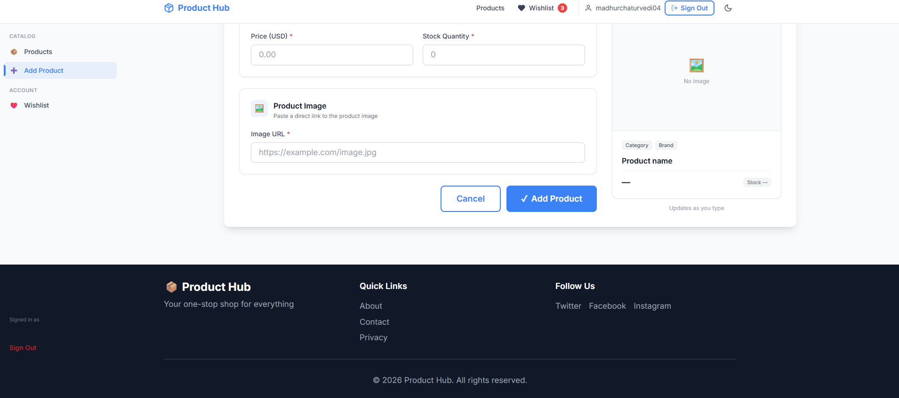
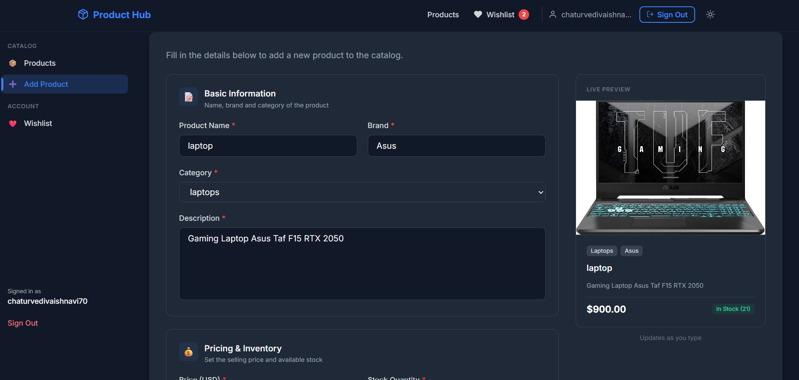
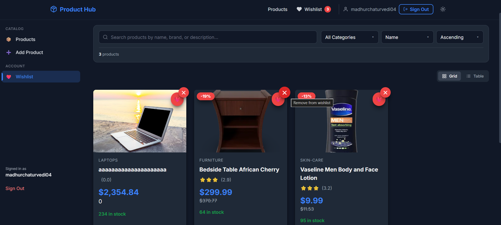

# 🛍️ Product Hub — Responsive Product Management Dashboard

A modern, responsive single-page application for browsing, managing, and organizing products. Built with **React**, **Vite**, and **Redux Toolkit** as a frontend technical assignment.

The dashboard integrates the [DummyJSON](https://dummyjson.com) API to deliver a complete product management experience — from listing and filtering to detailed views, wishlists, and product creation.

---

## 📸 Screenshots

### Product Listing

*Grid and table views with search, category filter, sorting, and pagination.*

### Product Details

*Image gallery, price hierarchy, stock status, and wishlist action.*

### Add Product

*Validated form with live preview, image URL, and real-time feedback.*

### Wishlist

*Saved products with the same filtering and sorting controls.*

### Dark Mode

*Full dark theme support across every page and component.*

---

## ✨ Features

### Product Discovery
- **Product listing** — responsive grid and table views
- **Search** — real-time search across name, brand, and description
- **Category filter** — dynamically fetched from the API
- **Sorting** — by name, price, or rating (ascending / descending)
- **Pagination** — server-side, with page numbers and prev/next controls
- **Layout toggle** — switch between card grid and compact table view

### Product Details
- Full product view with image gallery
- Interactive thumbnail strip
- Image zoom on hover (desktop)
- Price hierarchy with discount display
- Rating, stock status, brand, and category metadata
- Wishlist action with visual feedback

### Wishlist
- Add/remove products from any listing or detail view
- Persisted across page refreshes via `localStorage`
- Live counter badge in the header
- Same filter/sort/layout controls as the main listing
- Empty state with a call-to-action

### Add Product
- Full form validation (client-side)
- Live preview card that updates as you type
- Real `POST` request to DummyJSON
- Success/error toast notifications
- Session-persistent additions (see Limitations)

### User Experience
- **Dark mode** — full theme with `localStorage` persistence
- **Mock authentication** — login/signup with protected routes
- **Toast notifications** — success, error, info, and warning variants
- **Keyboard shortcuts** — `Ctrl/Cmd + K` to focus search, `Escape` to go back
- **Loading skeletons** — matching the real layout to avoid shifts
- **Error states** — with retry actions
- **Empty states** — contextual messaging with clear next steps

### Responsive & Accessibility
- Designed from **360px upward** — mobile, tablet, and desktop
- No horizontal overflow at any breakpoint
- Semantic HTML with proper ARIA attributes
- Visible focus states for keyboard navigation
- Touch targets sized for mobile
- `prefers-reduced-motion` support

---

## 🛠 Tech Stack

| Layer | Technology |
|-------|-----------|
| Framework | React 18 |
| Build tool | Vite |
| Language | **JavaScript (ES2020+)** — no TypeScript |
| Routing | React Router v6 |
| State | Redux Toolkit |
| Styling | Tailwind CSS + custom CSS |
| Icons | Inline SVG (no icon library) |
| API | [DummyJSON](https://dummyjson.com) |
| Persistence | `localStorage` |

---

## 🚀 Setup

### Prerequisites
- Node.js 18+ (20 recommended)
- npm 9+

### Installation

```bash
# Clone the repository
git clone https://github.com/<your-username>/product-management-dashboard.git
cd product-management-dashboard

# Install dependencies
npm install

# Create environment file
cp .env.example .env

# Start the dev server
npm run dev
```

Dev server runs on `http://localhost:5173` by default.

### Environment Variables

Create a `.env` file in the root directory:

```env
VITE_API_URL=https://dummyjson.com
VITE_APP_NAME=Product Hub
```

The `.env.example` file is committed so anyone can see which variables are required. The actual `.env` file is gitignored.

---

## 📦 Build

```bash
# Production build
npm run build

# Preview the production build locally
npm run preview
```

The build outputs to `dist/`. The app is a static SPA — deploy to Vercel, Netlify, or any static host.

---

## 📁 Project Structure

```
src/
├── components/
│   ├── common/           # Header, Sidebar, Footer, ProtectedRoute
│   ├── forms/            # Form inputs, AddProductForm and its preview
│   ├── products/         # ProductCard, ProductTable, ProductFilters, Pagination, LayoutToggle
│   ├── states/           # EmptyState, ErrorState, LoadingSpinner, Skeleton
│   └── ui/               # Button, Toast, ToastContainer
├── hooks/                # Custom hooks (useAuth, useProducts, useWishlist, useTheme, etc.)
├── layouts/              # MainLayout (header + sidebar + content + footer)
├── pages/                # Route-level pages (ProductListing, ProductDetailsPage, etc.)
├── store/                # Redux slices (auth, products, wishlist, filters, notifications, theme)
├── styles/               # Global CSS, animations, responsive tweaks, custom cursor
├── types/                # JSDoc typedefs
├── utils/                # Helpers, validation, constants, analytics
├── App.jsx               # Router + route definitions
├── main.jsx              # React entry point
└── index.css             # Tailwind directives + custom CSS imports
```

### Folder Purpose

- **`components/`** — Split by domain. `common/` holds cross-cutting layout pieces, `products/` holds everything product-specific, `ui/` holds reusable primitives.
- **`hooks/`** — Encapsulate stateful logic. Each hook has one job.
- **`store/`** — Redux Toolkit slices. One file per slice, one concern per slice.
- **`utils/`** — Pure functions for filtering, sorting, validating, and formatting.
- **`styles/`** — Global CSS organized by purpose: base styles, animations, responsive overrides.

---

## 🏗 Architecture & Approach

### Overall Approach

The project was built in incremental stages, each focused on a specific layer of the application:

1. **Foundation** — Project setup, folder structure, design tokens, routing skeleton
2. **API + State** — Service layer and Redux slices
3. **Listing** — Product grid with cards, loading skeletons, error/empty states
4. **Discovery Controls** — Search, category filter, sorting, pagination
5. **Details** — Full product view with image gallery and zoom
6. **Add Product** — Validated form with live preview and POST handling
7. **Wishlist** — Cross-page save/remove with persistence
8. **Polish** — Performance, accessibility, responsive refinements
9. **Final QA** — Bug fixes, README, deployment prep

### Key Architectural Decisions

**1. Separation of concerns**
- Network calls live only in `services/` and specific hooks
- UI components never call `fetch` directly
- Redux slices own global state; component state owns local concerns

**2. Local state vs. global state**
- **Global (Redux):** auth, products, wishlist, filters, notifications, theme
- **Local (useState):** form inputs, debounced search value, layout toggle in some pages
- The rule: if only one component tree reads it, keep it local

**3. API architecture**

The service layer (`useProducts` hook) wraps all product-related network calls. Component code calls hook methods like `fetchProducts()` and receives the result through Redux state.

**4. Search debouncing**

A `useDebounce` hook delays the search query by 300ms before it reaches the filter logic. This prevents firing a request on every keystroke while keeping the UX responsive.

**5. Session-only product additions**

DummyJSON's `POST /products/add` does not persist data. Successfully created products are stored in `state.products.localProducts` in Redux, then merged into the listing on page 1. They survive navigation but not a page refresh — documented in the Limitations section.

**6. Category filter via server**

Categories are fetched from `/products/categories` (returns ~24 categories). When a user picks a category, the app fetches that category's products from `/products/category/:slug` rather than filtering a small in-memory page.

**7. URL-synchronized state (partial)**

Filter state is stored locally in `ProductListing` for simplicity. Since the state is page-scoped, there's no need for URL sync — but the architecture makes it easy to add.

---

## 🧠 State Management

Redux Toolkit is used for six slices:

| Slice | Responsibility |
|-------|---------------|
| `auth` | Login state, user info (mock) |
| `products` | Product list, pagination, locally added products |
| `wishlist` | Saved products (persisted to `localStorage`) |
| `filters` | Search, category, sort, layout preferences |
| `notifications` | Toast messages |
| `theme` | Dark mode toggle (persisted) |

### Why Redux?

The app has **cross-cutting state** — for example, the wishlist counter in the header must reflect changes made from a product card, a details page, or the wishlist itself. Redux provides a single source of truth for this kind of shared data.

### What's Not in Redux

- Form state (React `useState` in `AddProductForm`)
- Debounced search value (local to `SearchBar`)
- Modal open/close state
- Image error state in individual cards

---

## 🌐 API

Base URL: `https://dummyjson.com`

| Endpoint | Used For |
|----------|----------|
| `GET /products` | Product listing with pagination |
| `GET /products/:id` | Single product details |
| `GET /products/search?q=` | Search (not currently wired into the listing) |
| `GET /products/categories` | Category list for the filter dropdown |
| `GET /products/category/:slug` | Products filtered by category |
| `POST /products/add` | Create a new product |

### Important Note About `POST`

**DummyJSON does not persist POSTed products.** The API returns the product with a synthesized `id`, but the product is not retrievable afterward. The app works around this by:

1. Storing the created product in Redux (`state.products.localProducts`)
2. Merging it into the listing on page 1
3. Displaying it in the details page by checking `localProducts` first

The user is informed in the Add Product form that the addition is session-only.

---

## ⚡ Performance

Optimizations actually implemented (no fake claims):

1. **Route-level lazy loading** — All non-critical pages load on demand via `React.lazy` + `Suspense`. The listing page loads eagerly since it's the entry point.

2. **Memoized components** — `ProductCard`, `ProductTable`, and `Pagination` are wrapped in `memo` because they re-render frequently with stable props.

3. **Debounced search** — 300ms delay via a reusable `useDebounce` hook, preventing excessive re-renders and API calls.

4. **Lazy-loaded images** — All product images use `loading="lazy"` and `decoding="async"`, with fixed aspect ratios to avoid layout shifts.

5. **Stable callbacks** — Event handlers in `useProducts`, `useWishlist`, and similar hooks are wrapped in `useCallback` to prevent unnecessary re-renders of memoized children.

6. **Skeleton loaders** — Loading states match the final layout so there are no jarring shifts when data arrives.

---

## ♿ Accessibility

- **Semantic HTML** — `<header>`, `<main>`, `<aside>`, `<nav>`, `<article>`, `<footer>` used meaningfully
- **ARIA labels** — Every icon-only button and interactive element has an `aria-label`
- **Focus states** — A visible focus ring (blue outline) on every focusable element
- **Keyboard navigation** — All interactive controls are reachable and operable with a keyboard
- **Keyboard shortcuts** — `Ctrl/Cmd + K` focuses the search input; `Escape` navigates back to products
- **Alt text** — All meaningful images have descriptive alt text; decorative images use `alt=""`
- **Live regions** — Toast notifications use `aria-live="polite"`
- **Reduced motion** — `prefers-reduced-motion` disables animations across the app
- **Focus trapping** — The mobile drawer, when open, prevents Tab from escaping
- **Touch targets** — Buttons have a minimum 44px height on mobile

---

## 📱 Responsive Design

The app is designed mobile-first with breakpoints at:

| Breakpoint | Layout |
|------------|--------|
| < 640px | Single column, hamburger menu, stacked filters |
| 640px+ | 2-column product grid |
| 768px+ | Sidebar visible, 3-column grid, filters inline |
| 1024px+ | 4-column grid, expanded spacing |
| 1280px+ | Content container capped at 1280px |

### Verified At
- 360px, 375px, 390px (mobile)
- 768px (tablet)
- 1024px, 1280px, 1536px+ (desktop)

No horizontal overflow, no clipped content, and consistent spacing at every breakpoint.

---

## ⚠️ Assumptions & Limitations

1. **No backend.** All data comes from DummyJSON, a public read-only mock API.

2. **Add Product is session-only.** Products created via the form appear in the listing for the current session but disappear on page refresh. This is a limitation of DummyJSON, not the app.

3. **Mock authentication.** Login and signup are simulated — any email with `@` and a password of 6+ characters logs you in. No real auth backend. The user session persists in `localStorage`.

4. **Wishlist persistence is browser-local.** Saved items live in `localStorage` under the key `wishlist`. Clearing site data will reset them.

5. **Categories come from DummyJSON.** The list is not user-managed and is limited to what the API provides (~24 categories).

6. **Search is client-side.** It filters the currently loaded products. For a real app, this would be server-side.

7. **DummyJSON limitations.** Some endpoints don't fully match their documentation. The implementation reads defensively (checking for arrays, handling both string and object responses).

---

## 🧾 Development Process

The project was built in clear, incremental stages:

1. **Setup and foundation** — Vite project, folder structure, design tokens, base styling
2. **API and state layer** — Custom hooks wrapping fetch calls, Redux slices for global state
3. **Listing page** — Cards, tables, skeletons, error/empty states
4. **Discovery controls** — Search, category, sort, pagination
5. **Product details** — Gallery, zoom, wishlist action
6. **Add product** — Form validation, live preview, POST handling
7. **Wishlist** — Redux slice with localStorage persistence
8. **Polish** — Performance, accessibility, responsive improvements
9. **Final QA** — Bug fixes, README, deployment prep

Each stage was tested in the browser before moving to the next, with fixes applied as issues surfaced.

---

## 🤖 AI Assistance

AI coding tools were used during development for scaffolding components, suggesting structure, and debugging. All generated code was reviewed, tested, and adjusted by hand. Bugs found during QA (session persistence, keyboard navigation, dark mode consistency) were diagnosed and fixed manually. The architectural decisions, state shape, and overall approach reflect the author's understanding of the code.

---

## ⏱ Approximate Development Time

Roughly **25–30 hours** of focused work spread across multiple sessions:

| Phase | Time |
|-------|------|
| Project setup and foundation | ~3h |
| API integration and Redux | ~3h |
| Product listing + cards + skeletons | ~4h |
| Search, filter, sort, pagination | ~4h |
| Product details + image gallery | ~3h |
| Add product form + validation | ~3h |
| Wishlist + persistence | ~2h |
| Responsive + accessibility polish | ~3h |
| Final QA + README + deployment | ~2h |

Time includes debugging, testing across breakpoints, and refining interactions.

---

## 📄 License

This project is built as a technical assignment and is available for review and educational purposes.

---

## 🙏 Acknowledgements

- [DummyJSON](https://dummyjson.com) for the free mock API
- [Vite](https://vitejs.dev) for the fast build tooling
- [Redux Toolkit](https://redux-toolkit.js.org) for simplified state management
- [Tailwind CSS](https://tailwindcss.com) for utility-first styling